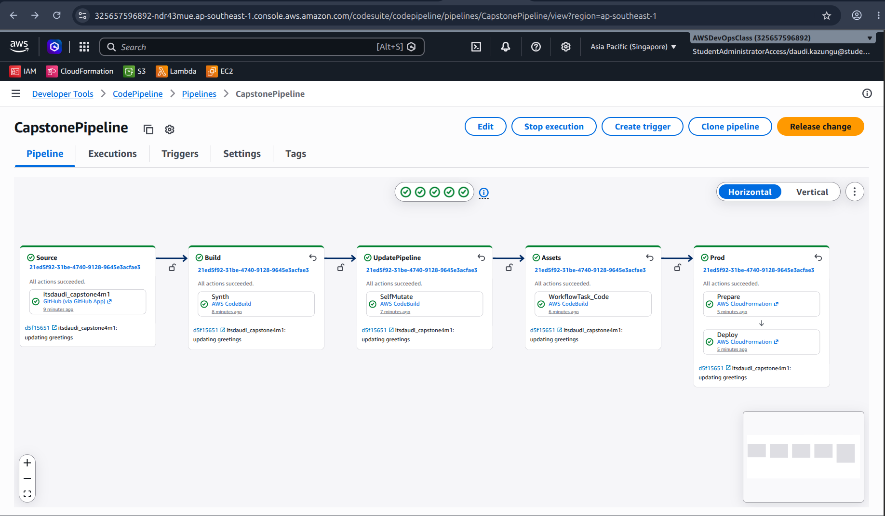
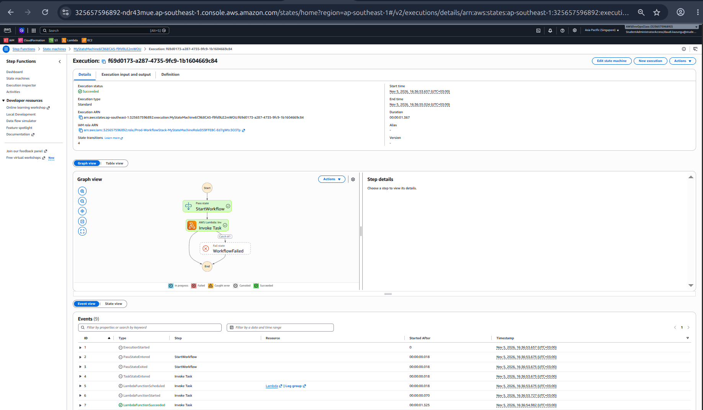
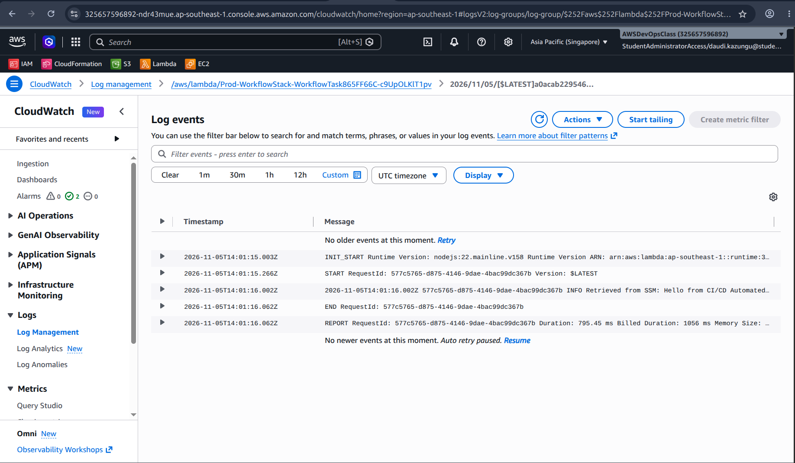

# Capstone 4: Automated IaC Pipeline with Step Functions and SSM

## Overview
An AWS CDK (TypeScript) project that deploys a serverless workflow through
an automated CI/CD pipeline. A push to `main` triggers CodePipeline, which
builds, synthesizes, and deploys the infrastructure.

## Architecture
GitHub (push) → CodePipeline → CodeBuild (synth) → CloudFormation
→ SSM Parameter + Lambda + Step Functions

- **SSM Parameter Store**: `/app/config/greeting` holds the configuration
- **Lambda**: reads the parameter at runtime (IAM via `grantRead`)
- **Step Functions**: Pass state → Lambda task, with Retry and Catch
- **CDK Pipelines**: self-mutating pipeline, deploys on every push

## Project structure
- `bin/capstone.ts`: app entry point
- `lib/pipeline-stack.ts`: CI/CD pipeline
- `lib/workflow-stage.ts`: deployment stage
- `lib/workflow-stack.ts`: SSM, Lambda, Step Functions
- `lambda/index.js`: Lambda source code

## How to deploy
npm install
cdk bootstrap
cdk deploy PipelineStack

After this, every push to `main` redeploys automatically.

## Evidence

### 1. Successful CodePipeline execution

### 2. Step Functions execution graph

### 3. Lambda reading from SSM (CloudWatch Logs)

## What I learned
(2 to 3 sentences about IaC, pipelines, and config separation)